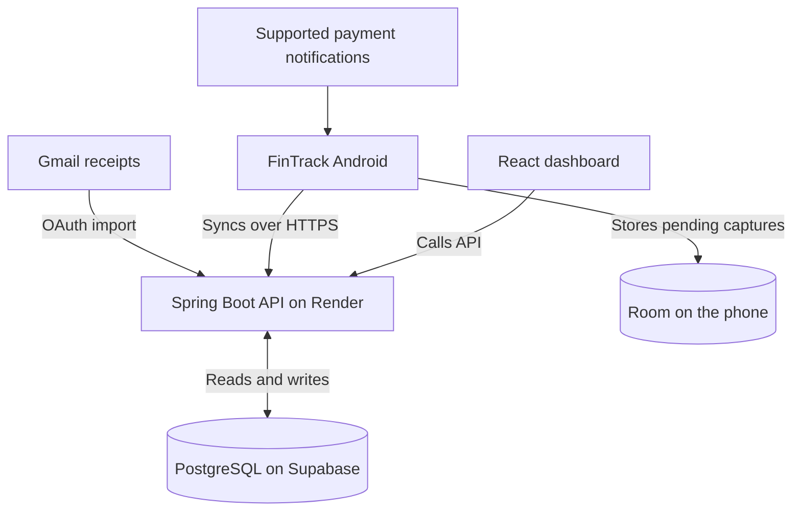

# FinTrack

Track personal cash flow in Peru from bank emails and Android payment
notifications. FinTrack brings expenses, income, and transfers into one
Spanish-language web dashboard.

[**Open FinTrack**](https://fintrack-api-txh9.onrender.com/) ·
[**Download for Android**](https://github.com/Fran0808/fin-track/releases/latest/download/fintrack.apk) ·
[Run locally](#run-locally)

## Get started

1. **Sign in with Google.** Use **Sincronizar ahora** on the dashboard to import
   supported receipts from the Gmail account you authorized.
2. **Connect Android.** Install FinTrack, open **Vinculación móvil** on the web
   dashboard, and tap **Escanear QR** in the app. Grant notification access to
   capture supported payments. If the dashboard is open on your phone, use the
   manual pairing option.

## What you can do

- Review monthly income, spending, net cash flow, and payment methods.
- Categorize transactions manually or create rules based on merchant names.
- Review uncategorized movements, add missing ones, and correct recorded details.
- Filter your transaction history by date, category, or payment method and export it to CSV.

FinTrack reports recorded movements in Peruvian soles (PEN). Transfers between
your own accounts are excluded from spending.

## Supported sources

| Source | Providers | What FinTrack reads |
| --- | --- | --- |
| Gmail | BCP, BBVA Perú, Interbank, Scotiabank Perú, and Yape | Supported transaction confirmation emails |
| Android | Yape | Supported payment notifications |
| Android | BBVA Perú, Interbank, and Scotiabank Perú | Incoming Plin notifications |

Capture depends on the receipt or notification format. Retries are deduplicated
per user. The same payment may appear twice if Gmail and Android both capture it.
See the [cash flow rules](docs/domain/cashflow.md) for details.

## Architecture



Render serves the dashboard and API from the same HTTPS origin. Android stores
pending captures on the device before syncing. The API validates and classifies
movements and scopes them to the signed-in user.
See the [architecture overview](docs/architecture/overview.md), the
[provider extension guide](docs/architecture/overview.md#provider-extension), and
the [API contracts](docs/architecture/contracts.md).

## Run locally

**Requirements** include PowerShell, Docker with Compose, Node.js 24 with npm,
and Google OAuth credentials. Android and native backend development also use
Java 21. The [development guide](docs/development/local.md) lists module-specific
prerequisites.

1. From the repository root, run `./scripts/setup/initialize-local.ps1 -Plan`
   to preview setup, then run it without `-Plan` to check prerequisites
   and create `.env` if needed.
2. Fill in local database, JWT, and Google OAuth settings using
   [`.env.example`](.env.example). Register
   `http://localhost:8080/api/v1/auth/google/callback` as the local Google callback.
   The [Docker guide](docker/README.md#setup) covers environment values and
   [existing database volumes](docker/README.md#existing-database-volumes).

```powershell
docker compose config --quiet
docker compose up -d --build
npm ci --prefix ui
npm run dev --prefix ui
```

Open the [local dashboard](http://localhost:5173). Vite forwards API requests to
port 8080. On a physical Android device, use a backend address reachable from
the phone. See [local Android setup](docs/development/local.md#dashboard-and-android-verification)
and [production deployment](docs/development/deployment.md).

## Repository guide

| Directory | Role |
| --- | --- |
| [`api/`](api/) | Java 21 and Spring Boot API for authentication, ingestion, classification, and analytics |
| [`ui/`](ui/) | React and TypeScript dashboard |
| [`android/`](android/) | Kotlin and Jetpack Compose app with Room and WorkManager |
| [`docker/`](docker/) | Local Compose setup and production API image |
| [`scripts/`](scripts/) | PowerShell tools and SQL migrations |
| [`docs/`](docs/README.md) | Architecture, development, and domain documentation |

## Verification and releases

```powershell
.\scripts\checks\verify-all.ps1 -Plan
.\scripts\checks\verify-all.ps1
```

The default verifier runs database-free API tests, dashboard tests and build,
and Android checks. Use a disposable database for
[backend persistence tests](docs/development/local.md#backend-verification).

GitHub Actions runs [CI](.github/workflows/ci.yml) and publishes versioned,
signed [Android releases](docs/android/releases.md). See
[project progress](docs/PROGRESS.md) for verification and pending work.
